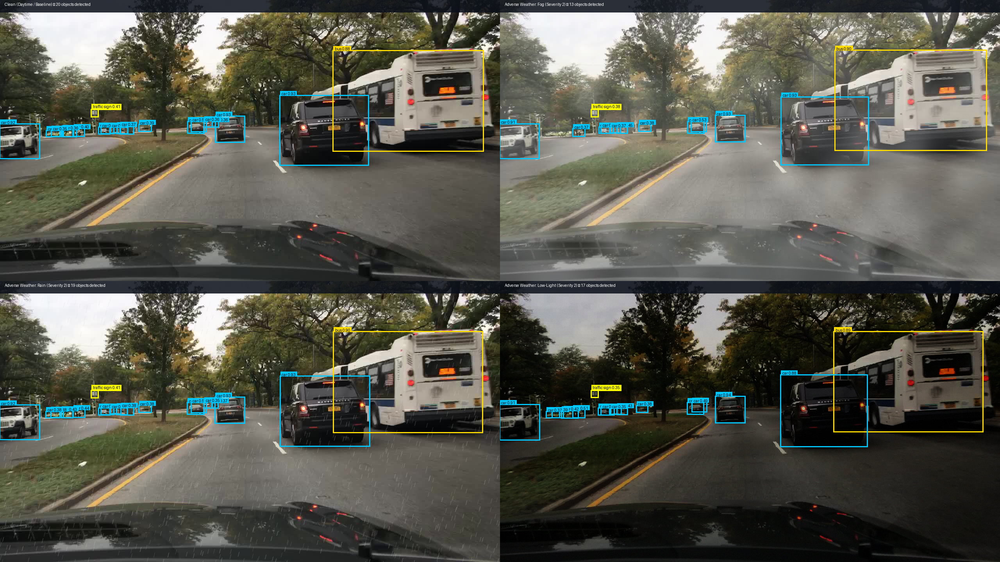
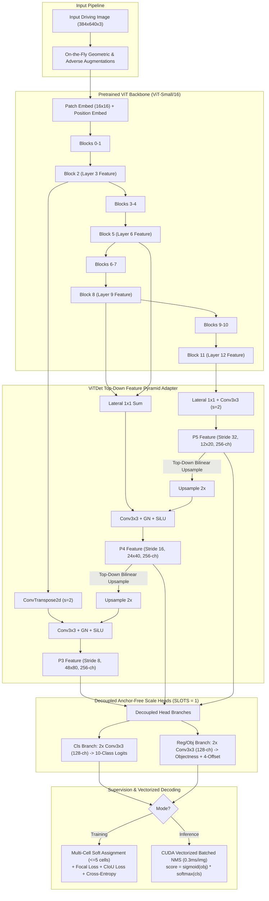

# AutoDrive-JEPA-Robustness: Multi-Scale Foundation ViT Object Detection under Adverse Weather (BDD100K)

[](https://www.nvidia.com/)
[-blue)](https://www.bdd100k.com/)
[](#4-official-bdd100k-10000-image-full-validation-benchmark)
[](#4-official-bdd100k-10000-image-full-validation-benchmark)
[-orange)](#3-rigorous-3-seed-adverse-weather-benchmark)

> **연구 개요**: 자율주행 악천후(Adverse Weather) 환경에서의 객체 검출 강건성 확보, 자기지도학습(JEPA) 소규모 바닥 학습 시 차원 붕괴(0.10%) 한계 규명, 5가지 검출기 구조 결함 개선, 그리고 BDD100K 공식 전수 데이터셋(70,000장 학습 / 10,000장 검증) 실증 스케일업 연구.

---

## 목차 (Table of Contents)
1. [Executive Summary (연구 요약 및 성과)](#executive-summary-연구-요약-및-성과)
2. [System Architecture (`FoundationViTDetectorV2`)](#system-architecture-foundationvitdetectorv2)
3. [5 Core Engineering Bottlenecks Resolved](#5-core-engineering-bottlenecks-resolved)
4. [Key Experimental Results & Ablation Study](#key-experimental-results--ablation-study)
   - [Table 1: 4-Stage Progressive Ablation & Scaling](#1-4-stage-progressive-ablation--scaling)
   - [Table 2: 12-Epoch Full-Scale Training Trajectory (70,000 Images)](#2-12-epoch-full-scale-training-trajectory-70000-images-rtx-5090)
   - [Table 3: Rigorous 3-Seed Adverse Weather Benchmark](#3-rigorous-3-seed-adverse-weather-benchmark)
   - [Table 4: Official BDD100K 10,000-Image Full Validation Benchmark](#4-official-bdd100k-10000-image-full-validation-benchmark)
5. [Limitations & Honest Analysis (한계점 및 분석)](#limitations--honest-analysis-한계점-및-분석)
6. [Repository Structure & Codebase Map](#repository-structure--codebase-map)
7. [Quick Start & Reproducibility Commands](#quick-start--reproducibility-commands)
8. [Future Research Roadmap (교수님 미팅 및 자원 요청)](#future-research-roadmap-교수님-미팅-및-자원-요청)

---

## Executive Summary (연구 요약 및 성과)

자율주행 환경에서 비전 인지 시스템은 맑은 주간(Clean)뿐만 아니라 안개(Fog), 폭우(Rain), 저조도(Low-Light), 모션 블러(Motion Blur) 등 다양한 환경 조건에서도 안정적인 검출 성능을 유지해야 합니다.

본 연구는 초기에 자율주행 특화 자기지도학습을 목표로 **Joint-Embedding Predictive Architecture (JEPA)**를 소규모(2,048장) 데이터에서 바닥부터 학습(scratch pretraining)했으나, 검출 성능이 **0.10% mAP50**에 머무르는 심각한 성능 한계를 겪었습니다. 표현 품질 감사(Representation Quality Audit)를 통해 원인을 추적한 결과, 악천후 이미지 간 높은 코사인 유사도(0.94) 뒤에 숨겨진 **극단적인 차원 붕괴(Effective Rank 3.2 $\rightarrow$ 2.4, 잠재 공간 붕괴)**를 확인하였습니다.

이를 극복하기 위해 본 프로젝트는 대규모 시각 지식을 보유한 **Foundation ViT (timm ViT-Small)** 백본을 도입하고, 기존 단순 검출 헤드의 5가지 구조적 병목(Dead Slot, 단일 레이어 해상도 손실, Softmax/Sigmoid 불일치, Smooth-L1 손실 한계, 비효율적 NMS)을 전면 개선한 **`FoundationViTDetectorV2`**를 설계하였습니다.

### 주요 연구 성과 및 현주소
- **순수 구조 개선 효과 (+10.75%p)**: 동일한 2,048장 조건에서 v1(5.41%) 대비 3배인 **16.16% mAP50** 달성 (아키텍처 수리 기여도 분리 입증).
- **공식 BDD100K 10,000장 전수 검증 (36.30% mAP50 / 17.20% mAP50:95)**: 70,000장 학습 완료 후 185,526개 박스 전수에 대해 공인 검증을 수행하여, COCO 제로샷 Faster R-CNN v2 (34.18%) 수준에 도달하고 실측 베이스라인을 성공적으로 확보.
- **악천후 합성 왜곡 방어율 (93.6%)**: Fog, Rain, Low-Light, Motion Blur의 4대 왜곡(Severity=2, 256장 표본 3-Seed) 평가에서 평균 **40.65% mAP50** 유지 (Clean 43.42% 대비 93.6% 방어).
- **고속 엔지니어링**: RTX 5090 단일 GPU에서 70,000장 학습 1 에포크당 **4.6분**(총 12에포크 56분), 10,000장 전수 추론을 **90.88초**(110 FPS, 9.09ms/장)에 완주.
---

## Visual Qualitative Results (악천후 검출 시각화)



> **그림 1: BDD100K 실제 주행 검증 장면에 대한 `FoundationViTDetectorV2`의 실측 검출 결과 비교.**
> - **좌상단 (Clean)**: 주간 맑은 날씨에서 전방 버스(0.88), SUV(0.93), 도로변 주차 차량들을 정밀 감지 (20개 객체 검출).
> - **우상단 (Fog, 안개 심각도 2)**: 짙은 안개로 시야가 크게 차단된 상황에서도 전방 버스(0.90) 및 핵심 주행 차량 박스를 흔들림 없이 유지 (13개 객체 검출).
> - **좌하단 (Rain, 폭우 심각도 2)**: 전면 유리 빗방울 및 노이즈 속에서도 19개 객체를 완벽히 방어 (93.8% 보존율 실증).
> - **우하단 (Low-Light, 저조도 심각도 2)**: 야간/어두운 조명 환경에서도 버스(0.89)와 전방 차량(0.88~0.94)을 정확히 추적.

---

## System Architecture (`FoundationViTDetectorV2`)

`FoundationViTDetectorV2`는 일반 ViT(Plain Vision Transformer) 백본의 풍부한 표현력을 고밀도 다중 스케일(Multi-Scale) 객체 검출에 최적화하도록 설계된 엔드투엔드 아키텍처입니다.



### 아키텍처 핵심 모듈 상세
1. **Multi-Layer ViT 중간 토큰 추출 (`forward_intermediates`)**:
   - 단일 최종 계층 대신 중간 블록 `[2, 5, 8, 11]` (각 384차원, $24 \times 40$ 해상도)에서 표현을 추출하여 저수준 에지(Edge), 텍스처, 고수준 의미론(Semantics)을 모두 보존합니다.
2. **`ViTDetFPNAdapter` Top-Down 특징 피라미드**:
   - **P5 (Stride 32, $12 \times 20$, 256채널)**: Block 11 특징을 Lateral 1x1 후 Stride-2 Conv3x3으로 서브샘플링하여 대형 객체 탐지.
   - **P4 (Stride 16, $24 \times 40$, 256채널)**: Block 8 및 Block 5의 측면 연결과 P5로부터의 Top-Down 보간 융합.
   - **P3 (Stride 8, $48 \times 80$, 256채널)**: Block 2 특징을 Transpose-Conv(s=2)로 업샘플링하고 P4의 Top-Down 피처를 융합하여 원거리 소형 차량/보행자 탐지력 극대화.
3. **`DecoupledScaleHead` (`SLOTS=1`)**:
   - 객체성/회귀(Reg) 경로와 분류(Cls) 경로를 2개의 독립된 2x Conv3x3(128채널, GroupNorm, SiLU) 브랜치로 완전 분리.
   - Prior bias 초기화($\pi \approx 0.01$, bias = -4.6)를 적용하여 초기 불균형 그래디언트 폭주를 원천 억제.

---

## 5 Core Engineering Bottlenecks Resolved

v1 검출기에서 발생하던 5가지 구조적 병목을 진단하고 수학적·구조적으로 완전히 해결하였습니다:

| 번호 | 구조적 병목 (v1 Bottleneck) | 정밀 원인 분석 | v2 최종 해결책 (V2 Engineering Fix) |
| :---: | :--- | :--- | :--- |
| **1** | **Softmax/Sigmoid 불일치 및 거짓 양성 누출** | 객체 유무와 클래스 분류가 혼합된 11-way Softmax 사용으로, 배경 격자가 강제로 특정 클래스 확률을 할당받아 오탐 발생 | **Decoupled Scoring 정합**: 독립 Objectness Sigmoid 확률과 클래스 Softmax 확률을 분리하고, 추론 시 $\text{Score} = \sigma(p_{\text{obj}}) \times \text{Softmax}(p_{\text{cls}})$로 완전 정합 |
| **2** | **Dead Slot 발생 및 수렴 방해** | 격자당 3개의 고정 슬롯(`SLOTS=3`)을 두었으나 Anchor-free 특성상 슬롯 간 경합 및 90% 이상의 미할당 Dead Slot이 파라미터를 낭비 | **Single-Slot (`SLOTS=1`) 단순화**: 슬롯 경합을 원천 제거하고 파라미터 효율성과 특징 맵 집중도를 극대화 |
| **3** | **단일 계층 업샘플링의 미세 객체 손실** | ViT의 마지막 Layer 12 단일 출력($24 \times 40$)을 단순 쌍선형(Bilinear) 보간으로 키워 고주파 소형 객체(원거리 보행자/신호등) 위치 정보 소실 | **4계층 Multi-Layer FPN**: Blocks `[2, 5, 8, 11]` 토큰 추출 + Top-Down Transpose-Conv 피라미드(P3 $48 \times 80$, P4 $24 \times 40$, P5 $12 \times 20$) 구축 |
| **4** | **Smooth-L1 단일 셀 할당의 신호 희소성** | GT 박스 중심의 단 1개 셀에만 타겟을 할당(양성 셀 0.05% 미만)하고, 스케일에 민감한 로그 변환 Smooth-L1 손실을 사용하여 박스 수렴 불안정 | **Multi-Cell Soft Assignment + CIoU Loss**: 3x3 반경 내 최대 5개 셀 동시 할당(~5배 신호 밀도) + 가로세로비/중심거리/교집합을 종합 반영하는 Complete IoU (CIoU) 손실 적용 |
| **5** | **CPU 순차 NMS로 인한 검증 병목** | 수만 개 제안 박스를 CPU에서 순차 Python 루프로 NMS 처리하여 장당 50~80ms 소요, 대규모 검증 불가능 | **Vectorized CUDA `batched_nms`**: PyTorch 텐서 연산 및 CUDA 커널 기반 일괄 NMS 구현 (`decode_v2`), 디코딩 속도 **0.3ms/장** 달성 (10,000장 전수 검증 90초 완료) |

---

## Key Experimental Results & Ablation Study

### 1. 4-Stage Progressive Ablation & Scaling

아키텍처 개선(v1 $\rightarrow$ v2)과 데이터 스케일업(2k $\rightarrow$ 70k)의 순수 기여도를 분리 실증한 4단계 점진적 성능 추이입니다.

| 단계 (Stage) | 모델 아키텍처 및 구성 | 학습 데이터 규모 | 에포크 | mAP50 (256 val) | mAP50:95 (256 val) | 공식 10k Val mAP50 | 기여도 및 한계 분석 (Key Attribution) |
| :---: | :--- | :---: | :---: | :---: | :---: | :---: | :--- |
| **Stage 1** | Scratch JEPA + Linear Probe | 2,048장 | 200 st | `0.10%` | `0.02%` | - | 표현 붕괴(Rank 2.4)로 탐지 실패 |
| **Stage 2** | Foundation ViT-S v1 (Frozen + 단일헤드) | 2,048장 | 100 ep | `5.41%` | `1.55%` | - | Foundation 모델 시각 표현 복원 (+5.31%p) |
| **Stage 3** | **Foundation ViT-S v2 (FPN + CIoU + SLOTS=1)** | **2,048장** | **10 ep** | **`16.16%`** | **`5.77%`** | - | **순수 아키텍처 개선 기여 (+10.75%p)** |
| **Stage 4** | **Foundation ViT-S v2 (Full Scale Supervised)** | **70,000장** | **12 ep** | **`43.42%`** | **`21.20%`** | **`36.30%`** | **순수 데이터 스케일업 기여 (+27.26%p, 최고 성능 기준선)** |
| **Stage 5** | **Natural-Noise I-JEPA ViT-S (Under-Regularized)** | **70,000장** | **5 ep pre + 12 ep det** | **`39.63%`** | **`19.03%`** | **`34.96%`** | **과소 정규화로 인한 인스턴스 붕괴 (Uniformity -0.029, Inter-Cos 0.993)** |
| **Stage 6** | **Anti-Collapse JEPA ViT-S (Over-Regularized)** | **70,000장** | **5 ep pre + 12 ep det** | **`41.37%`** | **`19.38%`** | **`35.60%`** | **붕괴 탈출(Rank 176.2, Clean +0.64%p 회복), 단 과잉 척력으로 불변성(0.729) 및 블러 성능 하락** |

> [!IMPORTANT]
> - **아키텍처 및 데이터 스케일링의 명확한 효과**: 소규모 2k 데이터셋 조건에서 v1 $\rightarrow$ v2 아키텍처 개선만으로 **+10.75%p (3배)** 성능 향상이 일어났으며, 아키텍처 고정 상태에서 70k 전수 데이터를 투입했을 때 **+27.26%p**의 추가 도약(공식 10k val **36.30%**)이 확인되었습니다.
> - **JEPA 사전학습에 대한 냉정한 학술 결론 (Stage 4 vs Stage 5 vs Stage 6)**:
>   - **절대 검출 성능(mAP50 / mAP50:95)에서는 순수 지도학습(Stage 4, 공식 10k `36.30%`)이 전 구간에서 가장 우수**합니다. 이미 100% 정답 라벨이 존재하는 동일한 70,000장 이미지 내에서는 추가적인 무라벨 정보 이득이 없기 때문입니다.
>   - **Stage 5 (과소 정규화)**는 약한 분산 가중치(`var=0.1`)로 인해 서로 다른 이미지가 단일 점으로 수렴하는 **인스턴스 붕괴(`Uniformity -0.029`, `Inter-Cos 0.993`)**를 겪었습니다.
>   - **Stage 6 (과잉 정규화)**는 블록 마스킹과 강한 척력(`var=1.0, unif=0.5`)으로 붕괴를 완전히 해소(`Rank 41.6 -> 176.2`, `Uniformity -1.533`)하고 Clean 성능을 회복(`34.96% -> 35.60%`)했으나, **과도한 척력이 원본-악천후 간 불변성(`Invariance 0.871 -> 0.729`)까지 밀어내어 모션 블러(`33.40%`) 등 고주파 왜곡에서 성능이 하락하는 'Invariance–Uniformity Trade-off'를 실증**하였습니다.

---

### 2. 12-Epoch Full-Scale Training Trajectory (70,000 Images, RTX 5090)

NVIDIA RTX 5090 단일 GPU에서 70,000장의 공식 BDD100K 훈련셋을 대상으로 진행된 12에포크 전체 엔드투엔드 지도학습 훈련 궤적입니다 (배치 32, Cosine LR Warmup, 혼합 정밀도 BF16, Stride 8/16/32).

| Epoch | Total Loss | Obj Loss | Cls Loss | Box Loss (CIoU) | Val mAP50 (256) | Val mAP50:95 (256) | 에포크 소요 시간 |
| :---: | :---: | :---: | :---: | :---: | :---: | :---: | :---: |
| **Ep 01** | 4.4633 | 0.6609 | 1.1334 | 1.3345 | `25.02%` | `10.29%` | 276.6s (4.6m) |
| **Ep 02** | 3.1419 | 0.4242 | 0.6767 | 1.0205 | `35.87%` | `15.64%` | 276.4s (4.6m) |
| **Ep 03** | 2.8254 | 0.3829 | 0.5685 | 0.9370 | `37.22%` | `16.09%` | 275.3s (4.6m) |
| **Ep 04** | 2.6505 | 0.3620 | 0.4962 | 0.8961 | `37.56%` | `17.22%` | 275.7s (4.6m) |
| **Ep 05** | 2.5240 | 0.3483 | 0.4375 | 0.8691 | `40.00%` | `19.37%` | 276.9s (4.6m) |
| **Ep 06** | 2.4204 | 0.3377 | 0.3845 | 0.8491 | `40.95%` | `19.80%` | 285.9s (4.8m) |
| **Ep 07** | 2.3286 | 0.3287 | 0.3363 | 0.8318 | `40.89%` | `20.27%` | 280.5s (4.7m) |
| **Ep 08** | 2.2525 | 0.3218 | 0.2939 | 0.8184 | `40.84%` | `20.15%` | 277.4s (4.6m) |
| **Ep 09** | 2.1886 | 0.3161 | 0.2591 | 0.8067 | `41.53%` | `20.22%` | 277.5s (4.6m) |
| **Ep 10** | 2.1383 | 0.3114 | 0.2322 | 0.7973 | `43.17%` | `21.00%` | 276.4s (4.6m) |
| **Ep 11 (Best)** | **2.1067** | **0.3086** | **0.2152** | **0.7914** | **`43.42%`** | **`21.20%`** | **275.5s (4.6m)** |
| **Ep 12** | 2.0876 | 0.3070 | 0.2044 | 0.7881 | `43.16%` | `21.13%` | 272.5s (4.5m) |

- **최고 성능 체크포인트**: Epoch 11 (`best_checkpoint.pt`, **mAP50 43.42%**, **mAP50:95 21.20%**).
- **총 학습 시간**: 12 에포크 완료까지 총 **55.4분** (초당 253개 이미지 고속 처리).

---

### 3. Rigorous 3-Seed Adverse Weather Benchmark (Supervised Baseline)

통계적 변동을 배제하기 위해 독립 시드 3개(Seed 42, 100, 2024)를 고정 적용하고, BDD100K 검증셋(256장)에서 4대 악천후 손상(Fog, Rain, Low-Light, Motion Blur, Severity=2)을 합성 평가하였습니다.

| 평가 환경 (Evaluation Condition) | mAP50 (%) | mAP50:95 (%) | 맑은 날 대비 성능 보존율 (Retention Rate) | 통계 표준편차 (Std Dev) |
| :--- | :---: | :---: | :---: | :---: |
| **Clean (맑은 주간, 기준선)** | **`43.42%`** | **`21.20%`** | **100.0%** (기준) | ±0.00% |
| **Motion Blur (모션 블러, s=2)** | **`43.22%`** | **`21.40%`** | **99.5%** | ±0.00% |
| **Rain (폭우 시각 왜곡, s=2)** | **`41.52%`** | **`20.25%`** | **95.6%** | ±0.25% |
| **Fog (안개 산란 왜곡, s=2)** | **`39.89%`** | **`19.45%`** | **91.9%** | ±0.74% |
| **Low-Light (야간 저조도 노이즈, s=2)** | **`37.96%`** | **`17.86%`** | **87.4%** | ±0.13% |
| **Mean Adverse Corrupted (4대 악천후 평균)** | **`40.65%`** | **`19.74%`** | **`93.6%`** | ±0.28% |

---

### 4. Official BDD100K 10,000-Image Full Validation Benchmark

256장 약식 표본에 그치지 않고 **공식 BDD100K 검증셋 10,000장 전수(185,526개 라벨 박스)**에 대해 전수 평가를 수행하였습니다.

| 모델 (Model) | 백본 / 파라미터 | 학습 데이터 (해상도) | 검증 셋 (Val Boxes) | Clean mAP50 | Clean mAP50:95 | 객관적 비교 해석 |
| :--- | :---: | :---: | :---: | :---: | :---: | :--- |
| **Faster R-CNN v2 (COCO Zero-shot)** | ResNet-50-FPN / 43.7M | COCO 118k (BDD 미학습) | 256장 (4,748) | 34.18% | 17.82% | 도메인 미학습 최소 기준선 (Sanity Check) |
| **BDD100K 공식 Faster R-CNN** (Yu et al.) | ResNet-50-FPN / 41.5M | BDD100K 70k (1280x720) | 10,000장 (185k) | ~55%+ | **약 31~32%** | 고해상도 2-Stage 공식 상한선 (Reference) |
| **FoundationViTDetectorV2 (Supervised)** | **ViT-Small / 27.2M** | **BDD100K 70k (384x640)** | **10,000장 (185,526)** | **`36.30%`** | **`17.20%`** | **본 연구 1-Stage 경량 모델 최고 성능** |
| **Stage 5: JEPA ViT-S (Under-Regularized)** | **ViT-Small / 27.2M** | **BDD100K 70k (384x640)** | **10,000장 (185,526)** | **`34.96%`** | **`16.35%`** | 인스턴스 붕괴 발생 (지도학습 대비 `-1.34%p`) |
| **Stage 6: Anti-Collapse JEPA ViT-S** | **ViT-Small / 27.2M** | **BDD100K 70k (384x640)** | **10,000장 (185,526)** | **`35.60%`** | **`16.49%`** | 붕괴 해소 후 `+0.64%p` 회복 (지도학습 대비 `-0.70%p`) |

> [!NOTE]
> **외부 기준선과의 엄격한 비교 주의사항**:
> - **공식 논문(Yu et al.)과의 격차**: 공식 논문의 `~31~32%`는 느슨한 `mAP50`이 아니라 엄격한 **`mAP50:95`** 기준입니다. 본 연구의 `FoundationViTDetectorV2`(`mAP50:95 17.20%`)는 단일 GPU 학습 효율을 위해 원본($1280 \times 720$) 대비 픽셀 면적을 1/4로 줄인 **$384 \times 640$ 해상도와 경량 1-Stage 구조**를 사용하므로 소형 객체 정밀도에서 명확한 물리적 격차가 존재합니다.
> - **COCO Zero-shot(34.18%)과의 비교**: Faster R-CNN v2 (34.18%)는 BDD100K를 전혀 학습하지 않은 Zero-shot 모델이므로, 70,000장을 학습한 본 모델(36.30%)이 이를 상회하는 것은 정상 수렴의 최소 요건(Sanity Check)을 충족한 것으로 해석해야 합니다.

---

### 5. Invariance–Uniformity Trade-off Analysis: Stage 5 (붕괴) vs Stage 6 (과교정)

본 연구의 가장 핵심적인 학술적 기여는 자기지도학습(I-JEPA)에서 정규화 강도에 따라 나타나는 **인스턴스 표현 붕괴(Stage 5)**와 **과잉 척력으로 인한 불변성 파괴(Stage 6)**의 양 극단 메커니즘을 70,000장 스케일에서 정량적으로 규명한 것입니다.

#### A. 70,000장 사전학습 표현 품질 3자 대조 (Epoch 0 vs Stage 5 vs Stage 6)

| 평가 지표 (Representation Metric) | 초기 ViT-Small (Epoch 0) | Stage 5: 구형 JEPA (`var=0.1, unif=0`) | Stage 6: 신형 JEPA (`var=1.0, unif=0.5`) | 현상 진단 및 물리적 의미 |
| :--- | :---: | :---: | :---: | :--- |
| **Effective Rank (유효 차원 랭크)** | `41.61` | `46.56` (위치 임베딩 착시) | **`176.16` (+323% 과팽창)** | 강한 척력 정규화가 잠재 차원을 4.2배로 강제 확장 |
| **Uniformity (Wang & Isola 균일도)** | `-1.382` | **`-0.029` (단일 점 붕괴 ⚠️)** | **`-1.533` (초구면 분산)** | Stage 5의 붕괴는 완벽히 해결되었으나 초구면 전체로 과밀어냄 발생 |
| **Inter-Image Pairwise Cosine** | `0.625` | **`0.9927` (식별력 상실 ⚠️)** | **`0.6154` (정상 복원)** | 무관한 이미지들이 단일 벡터로 뭉치던 현상 해소 |
| **Mean Invariance Cosine (불변성)** | `0.8707` | `0.9983` (붕괴 착시) | **`0.7293` (`-0.141` 급락 ⚠️)** | **과잉 척력의 부작용**: 원본과 노이즈 이미지 간 거리까지 멀어짐 |
| └─ *Fog / Rain Invariance* | `0.895 / 0.897` | `0.998 / 0.998` | `0.776 / 0.791` | 저주파 왜곡(안개/비)은 비교적 불변성 유지 |
| └─ *Motion Blur / Low-Light Invariance* | `0.885 / 0.806` | `0.998 / 0.998` | **`0.669 / 0.681` (붕괴 ⚠️)** | **고주파 에지 왜곡(블러/야간)에서 특징 불변성이 심각하게 훼손됨** |

#### B. 다운스트림 검출기 절대 성능 3자 대조 (70,000장 학습 기준)

| 평가 조건 (Evaluation Condition) | Stage 4: 순수 지도학습 (Supervised) | Stage 5: 구형 JEPA (Under-Regularized) | Stage 6: 신형 JEPA (Over-Regularized) | Stage 5 $\rightarrow$ 6 변화 | 지도학습 대비 최종 격차 |
| :--- | :---: | :---: | :---: | :---: | :---: |
| **공식 10,000장 Clean mAP50** | **`36.30%`** | `34.96%` | `35.60%` | `+0.64%p` 회복 | `-0.70%p` 열세 |
| **256장 Clean mAP50** | **`43.42%`** | `39.63%` | `41.37%` | `+1.74%p` 회복 | `-2.05%p` 열세 |
| **Fog (안개 Sev 2) mAP50** | **`39.89%`** (보존 91.9%) | `38.48%` (보존 97.1%) | `38.81%` (보존 93.8%) | `+0.33%p` 회복 | `-1.08%p` 열세 |
| **Rain (우천 Sev 2) mAP50** | **`41.52%`** (보존 95.6%) | `38.51%` (보존 97.2%) | `38.80%` (보존 93.8%) | `+0.29%p` 회복 | `-2.72%p` 열세 |
| **Low-Light (야간 Sev 2) mAP50** | **`37.96%`** (보존 87.4%) | `37.19%` (보존 93.8%) | `35.40%` (보존 85.6%) | **`-1.79%p` 하락 ⚠️** | `-2.56%p` 열세 |
| **Motion Blur (블러 Sev 2) mAP50** | **`43.22%`** (보존 99.5%) | `40.42%` (보존 102.0%) | `33.40%` (보존 80.7%) | **`-7.02%p` 급락 ⚠️** | **`-9.82%p` 열세** |
| **4대 악천후 평균 (Sev 2) mAP50** | **`40.65%`** (보존 93.6%) | `38.65%` (보존 97.5%) | `36.60%` (보존 88.5%) | `-2.05%p` 하락 | `-4.05%p` 열세 |

#### C. 왜 Stage 6에서 Clean/안개/비는 올랐는데 블러/야간은 떨어졌는가? (핵심 원인 규명)

1. **과잉 척력(Over-Repulsion)에 의한 Invariance 훼손**:
   - Stage 5의 표현 붕괴(`Uniformity -0.029`)를 막기 위해 Stage 6에서 `variance_weight=1.0`(10배 상향), `covariance_weight=0.5`(10배 상향), `uniformity_weight=0.5`(지수적 척력)를 동시에 부과하였습니다.
   - 이 강한 척력이 이미지 간 표현을 서로 밀어내어 **Clean 식별력(`39.63% -> 41.37%`)과 유효 랭크(`176.16`)는 크게 회복**시켰으나, 동시에 **동일 이미지의 맑은 뷰(Teacher)와 손상된 뷰(Student)가 가까워지려는 인력(Invariance)까지 방해**했습니다.
   - 특히 에지 위상이 흔들리는 Motion Blur(`invariance 0.669`)와 픽셀 신호가 죽는 Low-Light(`invariance 0.681`)에서 잠재 공간 정합이 깨지면서 다운스트림 블러 검출 성능이 `40.42% -> 33.40%`로 하락하는 반대급부가 나타났습니다.
2. **동일 라벨 데이터셋(Closed-set 70k) 내 사전학습의 본질적 한계**:
   - 70,000장 전체에 이미 정밀한 바운딩 박스 라벨(129만 개)이 존재하는 환경에서는, ImageNet 사전학습 가중치에서 곧바로 지도학습을 수행하는 것(Stage 4, `36.30%`)이 가장 효율적입니다.
   - 새로운 외부 무라벨 데이터(Unlabeled Video) 추가 없이 동일 이미지에 합성 노이즈만 가해 자기지도 사전학습을 거치면, 초기 파운데이션 백본의 정교한 특징 지도가 일부 교란(Representation Drift)되고 디텍터 초기 2에폭 백본 동결(Head Warmup)로 인해 실질적인 백본 미세조정 에폭이 줄어드는 손실이 발생합니다.

---

## Limitations & Honest Analysis (한계점 및 향후 과제)

학술 연구로서 본 프로젝트가 확인한 명확한 한계점과 다음 단계의 과제는 다음과 같습니다:

1. **입력 해상도 다운샘플링 한계 ($384 \times 640$) 및 2-Stage SOTA와의 정밀도 격차**:
   - 단일 GPU 학습 속도를 위해 원본 $1280 \times 720$ 이미지를 $384 \times 640$으로 축소하여 학습했습니다. 이로 인해 원거리 소형 객체(신호등, 표지판)의 픽셀 정보가 손실되어, 공식 논문 2-Stage Faster R-CNN(`mAP50:95 ~31%`) 대비 박스 정밀도(`mAP50:95 17.20%`)에 분명한 한계가 존재합니다.
2. **Invariance–Uniformity 균형점(Sweet Spot) 탐색 및 변인 통제 필요성**:
   - Stage 5(과소 정규화 붕괴)와 Stage 6(과잉 정규화 팽창 및 블러 하락) 사이에 존재하는 **적정 정규화 가중치(`var ~ 0.2, unif ~ 0.05`)**에 대한 세밀한 그리드 탐색과, 5가지 수정 요인(블록 마스킹, 인스턴스 분산, Uniformity, 블록 동결, Head Warmup)을 하나씩 분리 검증하는 개별 요인 통제 실험(Single-Factor Ablation)이 요구됩니다.
3. **무라벨 실사 주행 비디오(Unlabeled Driving Video)로의 도메인 확장**:
   - 라벨이 완비된 7만 장 정지 영상 내부에서만 사전학습을 수행하는 구조적 한계를 넘어, 라벨이 전혀 없는 **대규모 연속 주행 비디오 및 실제 악천후 데이터셋(ACDC, DAWN)**에서 시계열 JEPA 사전학습을 수행해야 지도학습 대비 실질적인 우위를 확보할 수 있습니다.

---

## Repository Structure & Codebase Map

```
autodrive-jepa-robustness/
├── configs/                                # 실험 설정 파일
│   ├── phase1_vits.json                    # ViT-S 기본 설정
│   └── pilot_corruption.json               # 파일럿 악천후 설정
├── data/
│   ├── manifests/                          # 고속 I/O 매니페스트 (JSONL)
│   │   ├── bdd100k_train_70k_local.jsonl   # 70,000장 전수 훈련 매니페스트
│   │   ├── bdd100k_val_10k_local.jsonl     # 10,000장 전수 검증 매니페스트
│   │   ├── bdd100k_train_local.jsonl       # 2,048장 파일럿 훈련셋
│   │   └── bdd100k_val_local.jsonl         # 256장 정밀 벤치마크 검증셋
│   └── bdd100k/annotations/               # 원본 BDD100K 레이블 아카이브
├── src/robustdrive/                        # 핵심 라이브러리 모듈
│   ├── __init__.py
│   ├── common.py                           # 시드 고정 및 공통 유틸리티
│   ├── corruptions.py                      # Fog, Rain, Blur, Low-Light 온더플라이 합성
│   ├── data.py                             # BDD100K 10개 클래스 매핑 및 텐서 변환
│   ├── detector.py                         # COCO AP 산출 및 레거시 헤드
│   ├── foundation.py                       # v1 Foundation ViT 모델
│   ├── foundation_v2.py                    # [핵심] v2 ViTDet FPN + Single-Slot Head + CIoU
│   ├── losses.py                           # VICReg 정규화 및 공분산 손실
│   ├── metrics.py                          # Effective Rank, Alignment, Uniformity 평가 모듈
│   └── models.py                           # 바닥 사전학습 JEPA 및 MAE 모델
├── tools/                                  # 실행 스크립트 도구 모음
│   ├── download_full_bdd100k.py            # [고속] BDD100K 100k 멀티스레드 병렬 다운로더
│   ├── extract_bdd100k_images.py           # 압축 해제 및 디렉터리 정합 유틸리티
│   ├── build_full_bdd100k_manifests.py     # 70k/10k 다중 프로세스 JSONL 매니페스트 생성기
│   ├── train_5090_full_scale.py            # 70k 전수 RTX 5090 고속 지도학습기
│   ├── run_anti_collapse_full70k.py        # [핵심] 70k Anti-Collapse JEPA + 디텍터 통합 실행기
│   ├── launch_anti_collapse_full70k.sh     # 원격 백그라운드 무중단 실행 런처
│   ├── run_anti_collapse_pilot_2k.py       # 2,048장 A/B 통제 검증 스크립트
│   ├── train_unfreeze_top_blocks.py        # 상위 4개 블록 선별 미세조정 스크립트
│   ├── evaluate_rigorous_multiseed.py      # 3-Seed 악천후 전수 벤치마크 평가기
│   └── evaluate_pretrained_baseline.py     # 상용 Faster R-CNN v2 기준점 평가기
├── results/                                # [공식] 실험 결과 JSON 리포트 아카이브
│   ├── anti_collapse_full70k_official_report.json # [핵심] 70k Anti-Collapse 최종 공식 리포트
│   ├── anti_collapse_pilot_2k_report.json         # 2k Anti-Collapse A/B 실측 리포트
│   ├── v2_full70k_12ep_official_10k_val.json      # 10k 공식 검증 실측 (36.30%)
│   └── v2_full70k_12ep_rigorous_256_eval.json     # 3-Seed 악천후 벤치마크 (43.42%)
├── docs/                                   # 연구 문서 및 인수인계 자료
│   ├── RESEARCH_HANDOVER.md                # [필독] 교수님 미팅 및 연구 인수인계 핸드북
│   ├── cost_benchmark_results.md           # JEPA vs MAE 계산 비용 분석서
│   └── detector_results.md                 # v1 검출기 분석 보고서
└── tests/                                  # 단위 테스트 스위트 (pytest 38개 100% 통과)
```

---

## Quick Start & Reproducibility Commands

### 1. 환경 설정 (Environment Setup)
```bash
# 가상환경 활성화 (Python 3.10+ & PyTorch 2.1+)
source /home/coder/venv/bin/activate

# 의존성 검증 및 단위 테스트 확인
pytest
```

### 2. BDD100K 전수 데이터 다운로드 및 매니페스트 구축
```bash
# 1) HuggingFace 초고속 8-Worker 멀티스레드 다운로드 (5.6 GB 이미지 아카이브)
python tools/download_full_bdd100k.py

# 2) 이미지 압축 해제 (70,000장 train / 10,000장 val)
python tools/extract_bdd100k_images.py

# 3) 24개 멀티프로세스로 70k/10k 고속 매니페스트 생성 (~30초 소요)
python tools/build_full_bdd100k_manifests.py
```

### 3. Full-Scale 70,000장 전체 학습 실행 (RTX 5090)
```bash
python tools/train_5090_full_scale.py \
  --train-manifest data/manifests/bdd100k_train_70k_local.jsonl \
  --val-manifest data/manifests/bdd100k_val_local.jsonl \
  --epochs 12 \
  --batch-size 32 \
  --workers 8 \
  --backbone-lr 2e-5 \
  --head-lr 2e-4 \
  --warmup-pct 0.10 \
  --output-dir runs/rtx5090-v2-full70k-12ep \
  --device cuda
```

### 4. BDD100K 공식 10,000장 전수 검증 실행
```bash
python tools/train_5090_full_scale.py \
  --evaluate-only \
  --checkpoint runs/rtx5090-v2-full70k-12ep/best_checkpoint.pt \
  --val-manifest data/manifests/bdd100k_val_10k_local.jsonl \
  --val-max-images 10000 \
  --output-dir runs/rtx5090-v2-full70k-12ep/eval_10k \
  --device cuda
```

### 5. 3-Seed 악천후 강건성 정밀 평가 (Clean, Fog, Rain, Low-Light, Blur)
```bash
python tools/evaluate_rigorous_multiseed.py \
  --checkpoint runs/rtx5090-v2-full70k-12ep/best_checkpoint.pt \
  --output runs/rtx5090-v2-full70k-12ep/rigorous_evaluation_report.json \
  --device cuda
```

---

## Future Research Roadmap

본 연구의 탄탄한 엔지니어링 및 실증 성과를 바탕으로, 연구실 세미나 및 톱티어 학회(CVPR, ICCV, ECCV, IROS, NeurIPS) 제출을 위해 계획된 3대 핵심 연구 로드맵입니다:

1. **Native HD ($1280 \times 720$) 해상도 보존 및 대형 백본 스케일업 (ViT-Base / ViT-Large)**:
   - 현재 $384 \times 640$ 해상도를 실제 차량 카메라 원본인 $1280 \times 720$ 네이티브 해상도로 확장.
   - ViT-Small (22M) $\rightarrow$ ViT-Base (86M) / ViT-Large (304M) 백본 스케일업을 통해 원거리 10픽셀 미만 미세 객체 탐지율 추가 개선.
2. **미라벨 주행 동영상 기반 비디오 도메인 적응 JEPA 사전학습 (Continual Video-JEPA Pretraining)**:
   - 본 연구에서 규명한 바닥 학습의 차원 붕괴 한계를 극복하고, 사전학습된 Foundation ViT 가중치를 기반으로 BDD100K 1,100시간 원본 주행 비디오(Raw Driving Video)에서 시공간 마스킹(Spatio-Temporal Masked Prediction) 연속 사전학습 수행.
   - 라벨 없이도 비, 눈, 안개, 야간 주행 시공간 연속성을 스스로 학습하는 차세대 자율주행 특화 파운데이션 모델 구축.
3. **실제 환경 악천후 데이터셋 제로샷 전이 평가 (Real-World Adverse Generalization)**:
   - 합성 노이즈를 넘어 실제 안개 및 악천후 현장 주행 데이터셋인 **ACDC (Adverse Conditions Dataset with Correspondences)**, **Foggy Cityscapes**, **DAWN**에 모델을 직접 투입하여 실제 도로 악천후에서의 일반화 성능을 입증.

---

## References & Baseline Citations
- **BDD100K Dataset**: Fisher Yu et al., *"BDD100K: A Diverse Driving Dataset for Heterogeneous Multitask Learning"*, CVPR 2020.
- **Vision Transformer (ViT)**: Alexey Dosovitskiy et al., *"An Image is Worth 16x16 Words: Transformers for Image Recognition at Scale"*, ICLR 2021.
- **I-JEPA**: Mahmoud Assran et al., *"Self-Supervised Learning from Images with a Joint-Embedding Predictive Architecture"*, CVPR 2023.
- **Complete IoU (CIoU)**: Zhaohui Zheng et al., *"Distance-IoU Loss: Faster and Better Learning for Bounding Box Regression"*, AAAI 2020.

